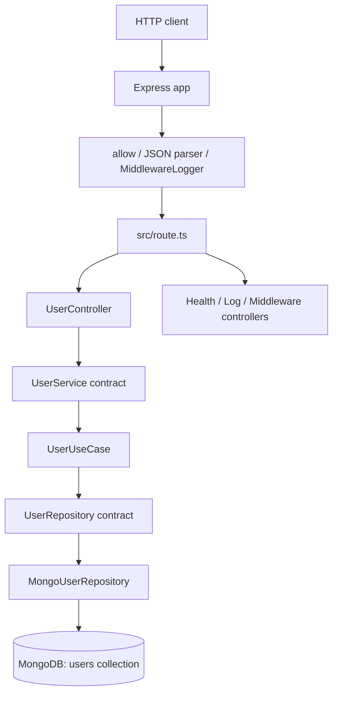

# Architecture and Module Guide

## 1. Architectural shape

The application is a small modular Express server. The implemented `user` feature separates HTTP handling, use-case behavior, and persistence behind interfaces.



`UserUseCase` currently extends the generic `UseCase` and adds no feature-specific methods. The repository extends the generic MongoDB `Repository`. This makes the feature thin: the sample demonstrates wiring and conventions rather than complex business logic.

## 2. Application startup

`src/app.ts` performs the following work:

1. Creates a logger using `config.log`.
2. Loads `.env` through `dotenv.config()`.
3. Builds `cfg` using `merge(config, process.env, env, process.env.ENV)`.
4. Creates the Express application.
5. Constructs `MiddlewareLogger` with the logger, middleware configuration, and three callbacks: `buildContext`, `encryptResponse`, and `encryptRequest`.
6. Registers CORS/allow handling, JSON parsing, and the logging middleware.
7. Connects to MongoDB with `connectToDb(cfg.mongo.uri, cfg.mongo.db)`.
8. After a successful connection, creates the application context, registers routes, and starts the HTTP server on `cfg.port`.

If the MongoDB connection rejects, the current code logs the error to the console. It does not start the HTTP listener in that failure path.

### Request context and masking hooks

- `buildContext` copies `X-Request-ID` and `X-Correlation-ID` into the middleware context, defaulting each to an empty string.
- `encryptRequest` and `encryptResponse` are named as encryption hooks, but their visible behavior is **masking**, not cryptographic encryption. They mask top-level `phone` and `email` properties using `mask(...)`.
- The response hook parses JSON and re-serializes it. If parsing fails, it logs an error and returns the original response string.
- Do not treat this masking as a substitute for encryption at rest, transport security, access control, or comprehensive PII handling.

## 3. Dependency composition

`src/context.ts` is the composition root.

`ApplicationContext` currently exposes:

- `health: HealthController`
- `log: LogController`
- `middleware: MiddlewareController`
- `user: UserController`

`useContext(db, logger, midLogger)` constructs these dependencies explicitly:

- `LogController(logger, updateLogger)`
- `MiddlewareController(midLogger)`
- `MongoChecker(db)` inside `HealthController`
- The user controller through `useUserController(db)`

There is no general-purpose DI container in the supplied source. Add feature wiring explicitly in this factory and its context interface.

`resources.createValidator = createValidator` is also assigned in this file, connecting the shared resource facility to `validation-core`.

## 4. User feature composition

```mermaid
flowchart TD
    A[index.ts: useUserController(db)] --> B[MongoUserRepository]
    A --> C[UserUseCase]
    A --> D[UserController]
    B --> E[Repository<User, string, UserFilter>]
    B --> F[(users collection)]
    C --> G[UseCase<User, string, UserFilter>]
    D --> H[UserService interface]
    H --> C
    C --> I[UserRepository interface]
    I --> B
```

The implementation is split across:

| File | Responsibility |
|---|---|
| `src/user/user.ts` | `User`, `UserFilter`, repository/service contracts, and `userModel` validation metadata |
| `src/user/repository.ts` | `MongoUserRepository`, extending `Repository<User, string, UserFilter>` and selecting collection `users` |
| `src/user/service.ts` | `UserUseCase`, extending `UseCase<User, string, UserFilter>` |
| `src/user/controller.ts` | Express handlers, validation, response codes, and error handling |
| `src/user/index.ts` | Constructs repository → use case → controller; re-exports controller and model types |

### Typical request path

For a create request:

1. Express dispatches `POST /users` to `ctx.user.create`.
2. The controller obtains localized validation resources using `getResource(req)`.
3. The body is treated as `User` and checked with `validate<User>(user, userModel, resource)`.
4. Validation errors are returned with `getStatusCode(errors)`.
5. Otherwise, the controller calls `service.create(user)`.
6. A successful result is returned with HTTP 201; an unsuccessful result is returned with HTTP 409.
7. Exceptions are passed to `handleError(err, res)`.

The other handlers follow the same general boundary: parse request values, invoke the service, map result to an HTTP response, and delegate exceptions to `handleError`.

## 5. Routes and context must stay synchronized

Feature additions normally require both:

- `src/context.ts`: add the controller to `ApplicationContext` and construct it in `useContext`.
- `src/route.ts`: register its route handlers.

The feature factory should own the construction of its repository, service, and controller. The route module should only map HTTP methods/paths to controller methods; it should not create repositories or services.

## 6. Resources and localization

- `src/resources/en.ts` and `src/resources/vi.ts` contain validation labels and messages.
- `src/resources/index.ts` merges these objects into the `resources` map.
- `getResource(lang)` accepts either a language string or an Express `Request`.
- When passed a request, it reads the `lang` query parameter through `query(req, "lang")`.
- Unknown or missing language values fall back to English.

Add the same message keys to both language files when introducing user-facing validation text, and use resource keys in `userModel` rather than hard-coding translated labels there.

## 7. Configuration and runtime concerns

- Static defaults and environment profile objects are in `src/config.ts`.
- `.env` is loaded in `src/app.ts`.
- The profile map currently contains `sit` and `prd`.
- The configured HTTP port defaults to `8080`.
- MongoDB is the only database connection visible in the app lifecycle.

One source-level ordering concern: `createLogger(config.log)` runs before `dotenv.config()` and before the merged `cfg` is created. The `prd` profile changes `log.level`, but the initial logger is created from the base `config.log`, not `cfg.log`. Verify the intended `config-plus` and logger behavior before changing initialization order or assuming the profile override applies to the logger.

## 8. Current scope and limitations

Observed in the supplied archive:

- One feature module: `user`.
- No PostgreSQL client or pool.
- No migrations or schema-management scripts.
- No tests or configured test framework.
- No auth middleware or authorization policy is visible in the route setup.
- No modules for company ratings, follows, jobs, articles, saved items, or the other supplied SQL entities.

These are scope observations, not recommendations to implement all missing features at once. Add only what a feature requirement needs.
